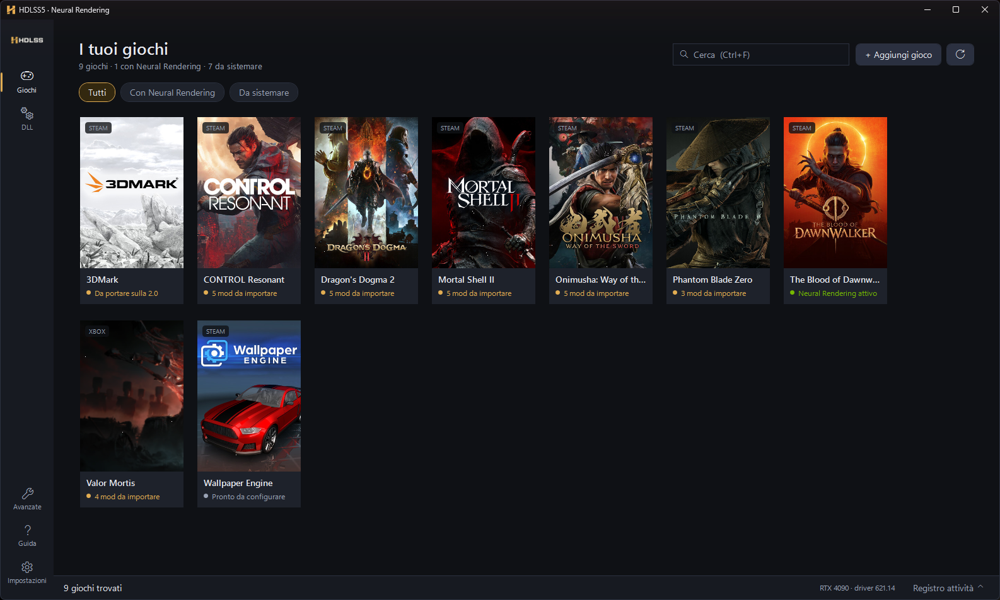
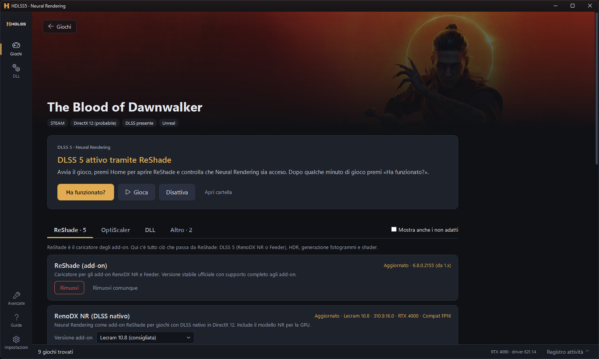
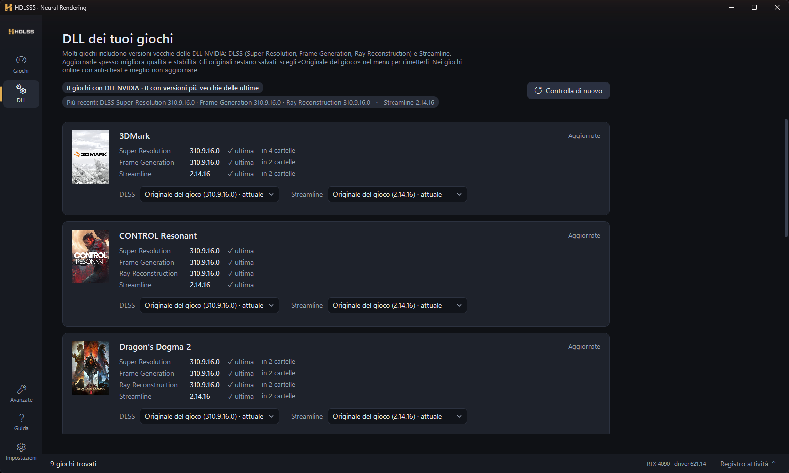

# HDLSS5 2.0

**DLSS 5 Neural Rendering, DLSS aggiornato e HDR nei tuoi giochi PC, con un clic e sempre annullabile.**

HDLSS5 trova i giochi installati sul PC, capisce come sono fatti (motore, API grafica, DLSS presente, anti-cheat) e installa le mod giuste nel posto giusto: ReShade con RenoDX NR, OptiScaler, il modello NR adatto alla tua GPU, le DLL DLSS e Streamline più recenti, mod HDR e loader. Ogni file sostituito viene salvato prima, quindi puoi sempre tornare indietro.

**[⬇ Scarica HDLSS5 2.0](https://github.com/giorgiobascialla-hub/Ourze/releases/latest)**



## Cosa fa

- **Libreria automatica**: trova i giochi Steam e Xbox / Game Pass; gli altri si aggiungono a mano. Ogni copertina dice in una riga com'è messo il gioco (Neural Rendering attivo, mod da importare, da configurare…).
- **Un pulsante per partire**: la pagina del gioco spiega la situazione in italiano semplice e propone una sola azione principale, ad es. «Attiva Neural Rendering».
- **«Ha funzionato?»**: dopo qualche minuto di gioco legge i log e ti dice se il Neural Rendering è partito davvero.
- **Sempre annullabile**: ogni modifica finisce nella cronologia; «Rimuovi» rimette i file originali del gioco.
- **Stato chiaro**: «Installa» solo se manca, «Aggiorna» solo se c'è davvero una versione più recente; se per un gioco una mod non esiste, l'app lo dice.



## Componenti

| Scheda | Cosa contiene |
|---|---|
| **ReShade** | ReShade, RenoDX NR (Lecram 10.8 o ShortFuse), Feeder, mod HDR RenoDX, MFG Unlock (RTX 4000), shader Lilium e CAS |
| **OptiScaler** | OptiScaler Standard e F5, con ReShade caricato da OptiScaler senza conflitti |
| **DLL** | Modello NR 310.9.16.0 per RTX 4000/5000, DLSS (Super Resolution, Frame Generation, Ray Reconstruction) e Streamline |
| **Altro** | HDR Unreal (Engine.ini), UE4SS con lettore HDR, Ultimate ASI Loader, REFramework |

## Pagina DLL

Tutte le DLL NVIDIA dei tuoi giochi in un colpo d'occhio, confrontate con le più recenti. Per ogni gioco scegli la versione più recente, una precedente o «Originale del gioco».



## Requisiti

- Windows 10/11 a 64 bit, nessun runtime da installare.
- GPU NVIDIA RTX; per il Neural Rendering RTX 4000 o RTX 5000 con driver aggiornato.
- Interfaccia in italiano.

## Installazione

1. Scarica `HDLSS5-Portable-2.0.0.zip` dall'[ultima release](https://github.com/giorgiobascialla-hub/Ourze/releases/latest).
2. Estrailo in una cartella scrivibile (non in «Programmi») e avvia `HDLSS5.exe`.
3. Chiudi sempre il gioco prima di installare o rimuovere qualcosa.

L'app non è firmata digitalmente: Windows SmartScreen può chiedere conferma al primo avvio («Ulteriori informazioni» › «Esegui comunque»). Puoi verificare lo zip con il file `.sha256` della release.

**Arrivi dalla 1.x?** La 2.0 riconosce le installazioni fatte con HDLSS5 1.x e può prenderle in gestione senza toccare i file del gioco, oppure ripristinare gli originali con i backup della 1.x. La 1.5.1 resta tra le [release precedenti](https://github.com/giorgiobascialla-hub/Ourze/releases).

Nei giochi con anti-cheat (EasyAntiCheat, BattlEye) l'installazione è bloccata. HDLSS5 è un progetto indipendente, non affiliato a NVIDIA; i componenti vengono scaricati dai repository ufficiali dei rispettivi autori e verificati.

## Per sviluppatori

Riscrittura da zero della 1.5 in **.NET 8 + WPF (MVVM)**.

```
src/Hdlss.Core     logica senza UI (testabile)
  IO/              PathGuard, FileHash, PeFile, IniDocument, Archives
  Storage/         AppPaths, ContentStore (backup per contenuto), JsonFile
  Transactions/    PlanBuilder, RemovalPlanner, TransactionEngine
  Games/           GameLibrary (Steam, Xbox, manuali), ExecutableDetector
  Net/             HttpService (cache ETag, download verificati)
  Components/      ReShade, RenoDX, OptiScaler, modello NR, DLL, HDR, loader
  Legacy/          lettura e ripristino delle installazioni 1.x
src/Hdlss.App      WPF: AppHost, ViewModels, Views
tests/             xUnit
bundled/           add-on RenoDX NR inclusi (verificati via SHA-256)
```

```bash
dotnet build HDLSS5.sln -c Release
```

```bash
dotnet test tests/Hdlss.Core.Tests
```

Pacchetto portatile completo (con i modelli NR): `.\build-portable.ps1`.
